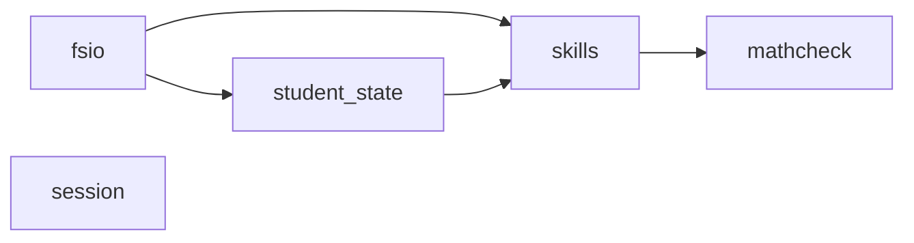
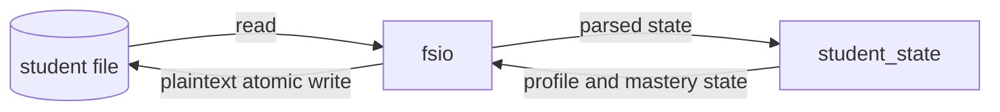

<!-- Generated by scripts/diagram. Do not edit (protected gate file). -->
<!-- stamp: graph=cdca781b808d9947 privacy=6cf725b2d54b89ed -->
# As-built architecture

## Components

## Data flow

## Verified component edges

importer -> imported, from the grimp import graph:

- fsio -> skills
- fsio -> student_state
- skills -> mathcheck
- student_state -> skills
