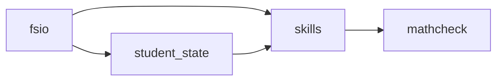
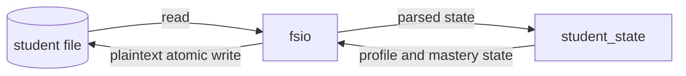

<!-- Generated by scripts/diagram. Do not edit (protected gate file). -->
<!-- stamp: graph=8ab3a03e3240fb51 privacy=098f5487a8e47706 -->
# As-built architecture

## Components

## Data flow

## Verified component edges

importer -> imported, from the grimp import graph:

- fsio -> skills
- fsio -> student_state
- skills -> mathcheck
- student_state -> skills
